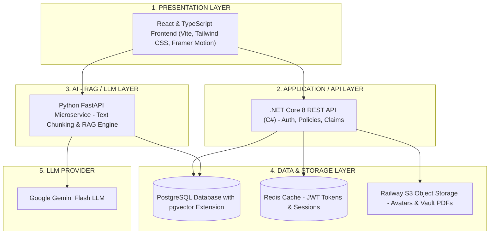
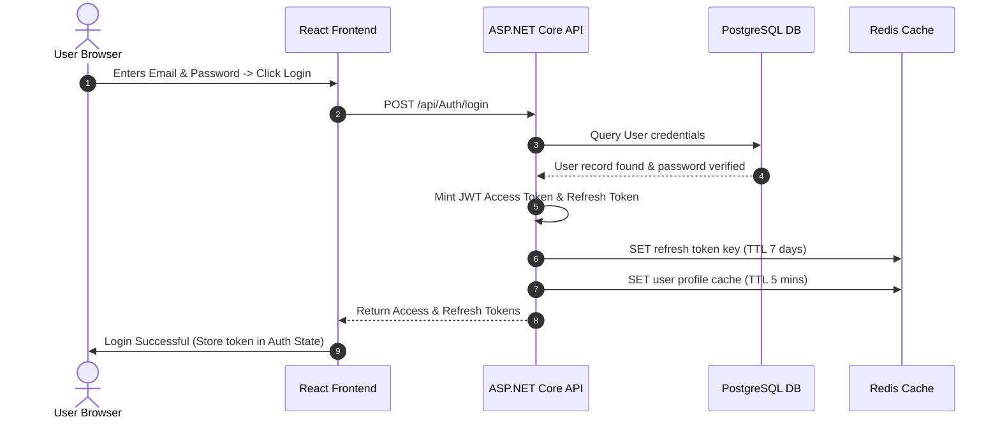
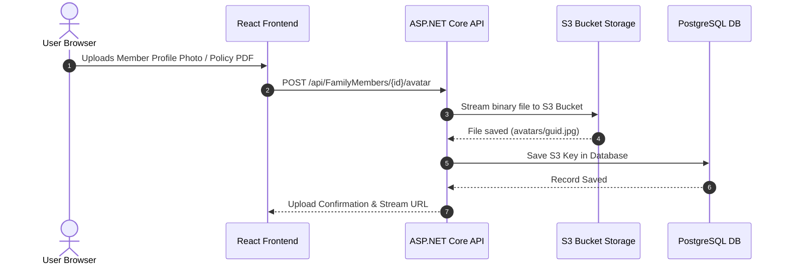
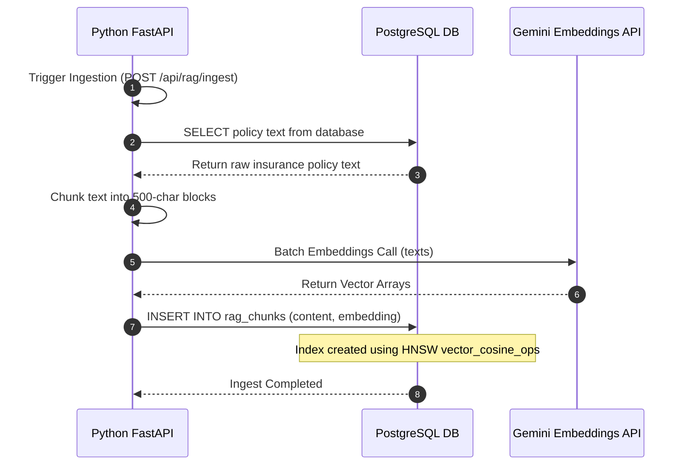
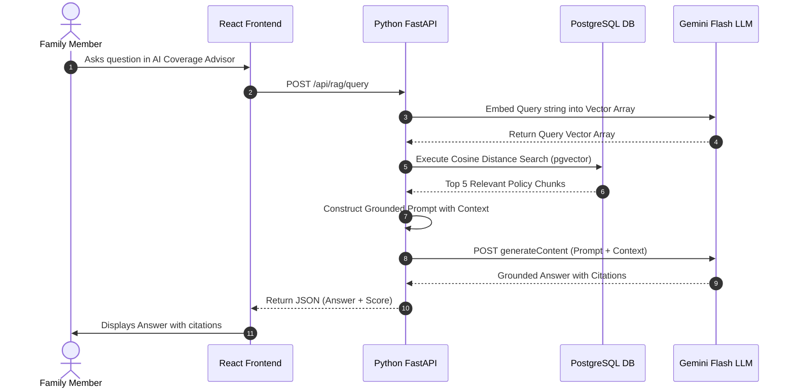

# Complete System Architecture & End-to-End Data Flow Guide — ClanSure

This document provides a comprehensive technical breakdown of how the **ClanSure Family Insurance & Health Protection Portal** works end-to-end — from the **Presentation Layer (React Frontend)** through **ASP.NET Core API**, **Python FastAPI RAG Microservice**, **PostgreSQL & pgvector**, **Redis Cache**, **Railway S3 Bucket Storage**, and **Google Gemini Flash LLM**.

---

## 🏗️ 1. High-Level Architecture Overview

ClanSure follows a **Decoupled Microservice & Layered Architecture** hosted on **Railway.com**:

---

## 🔄 2. End-to-End Data Flow Breakdown

---

### Flow 1: User Authentication & Session Management (Core Auth Flow)

1. **User Request**: User enters credentials on the React Frontend (`Family Insurance Portal`).
2. **API Request**: Request hits the **ASP.NET Core REST API** (`backend-service`).
3. **Database Check**: ASP.NET Core verifies user credentials against the **PostgreSQL** `Users` table.
4. **Token Generation**: ASP.NET Core generates a short-lived JWT Access Token & a 7-day Refresh Token with a unique `jti`.
5. **Redis Caching**:
   - Refresh Token `jti` is stored in **Redis** with a 7-day TTL for instant revocation checking upon logout/refresh.
   - User profile mapping is cached in **Redis** under `user:{id}:profile` with a 5-minute TTL to reduce database query load.
6. **Response**: Tokens are returned to the React Frontend.

---

### Flow 2: Member Profile Photo & Document Vault Upload Flow

1. **Upload Request**: User uploads a profile picture or policy vault document in the React Frontend.
2. **S3 Object Storage**: The file binary is streamed directly into the Railway Tigris S3 Bucket (`compact-tin-tkmehua6m5gru`).
3. **Metadata Persistence**: The generated S3 Key (e.g. `avatars/guid.jpg`) and document metadata are stored in PostgreSQL tables (`FamilyMembers`, `VaultDocuments`).
4. **Streaming Endpoint**: Avatar images are served back to any browser via `GET /api/FamilyMembers/avatar-file?key=...`.

---

### Flow 3: AI Vector Ingestion Pipeline (RAG Ingest Flow)

1. **Ingest Signal**: Ingestion is triggered via FastAPI (`POST /api/rag/ingest`).
2. **Fetch Source Content**: FastAPI queries PostgreSQL database to fetch raw text from insurance policies and health coverage directives.
3. **Text Chunking**: Raw content is split into overlapping chunks (500 characters, 100-character overlap) along sentence boundaries.
4. **Vector Embedding**: Text chunks are sent to the embedding model (Google Gemini Embedding), producing high-dimensional vector arrays.
5. **`pgvector` Ingestion**: Chunks and vector arrays are stored in the PostgreSQL **`rag_chunks`** table. An **HNSW index** (`vector_cosine_ops`) enables sub-millisecond similarity lookups.

---

### Flow 4: AI Protection Score & RAG Assistant Query Flow

1. **User Question**: User asks about policy coverage or requests a health gap analysis in the AI Advisor Chat widget.
2. **Direct Microservice Call**: React sends a direct request to Python FastAPI (`POST /api/rag/query`).
3. **Query Embedding**: FastAPI converts the user's question into a vector using the embedding model.
4. **Vector Similarity Search**: FastAPI queries PostgreSQL `rag_chunks` using `pgvector`'s Cosine Distance operator (`<=>`).
5. **Prompt Augmentation**: Top-5 retrieved policy passages are structured into a grounded prompt:
   > *"You are an AI Insurance Advisor for ClanSure. Answer the user's query using ONLY the verified policy context below. Cite passages as [1], [2]..."*
6. **LLM Generation**: The prompt is sent to **Google Gemini Flash**.
7. **Response to User**: Gemini's response, complete with citations and Protection Score adjustments, is returned to the React UI for rendering.

---

## 🌐 3. Infrastructure & Deployment Overview (Railway.com)

All services run seamlessly on **Railway.com** in a unified project environment:

| Service Name | Technology / Stack | Role & Function |
| :--- | :--- | :--- |
| **`Family Insurance Portal`** | React 18 + TypeScript + Vite | Presentation Layer (Web UI for family members & admins) |
| **`backend-service`** | ASP.NET Core 8 (.NET API) | Application Layer (Auth, Family Tree Logic, Policies, Claims, S3 Streaming) |
| **`AI RAG API`** | Python FastAPI | AI Microservice (RAG, Chunking, Vector Search, Gemini Integration) |
| **`Postgres 😋`** | PostgreSQL 16 + `pgvector` | Unified Database (Application tables + `rag_chunks` Vector Store) |
| **`Redis 📊`** | Redis In-Memory Cache | Cache Layer (JWT Refresh tokens, Session IDs, Profile cache) |
| **`Family 👨‍👩‍👧‍👦`** | Railway Tigris S3 Storage | Object Storage (Uploaded member avatar photos, policy PDFs, receipts) |
| **Gemini API** | Google AI Studio (Gemini Flash) | LLM Provider (Embedding generation & RAG chat completions) |

---

## 🌟 Key Technical Highlights for Presentation / PPT

- **Interactive Family Protection Tree**: Custom SVG connector algorithm calculating exact parent marriage lines and child distribution stems.
- **Grounded AI Advice**: RAG pipeline ensures insurance answers are based strictly on verified policy documents, eliminating LLM hallucinations.
- **Enterprise Cloud Security**: Dual-layer security with JWT Access/Refresh tokens managed via Redis blacklisting and S3 signed streaming.
- **Unified Vector & Relational Storage**: Storing vectors inside PostgreSQL via `pgvector` avoids external third-party vector databases, reducing complexity and cost.
- **Sub-Second Latency**: `HNSW` indexing in `pgvector` + Redis profile caching guarantees fast response times under 50ms.
